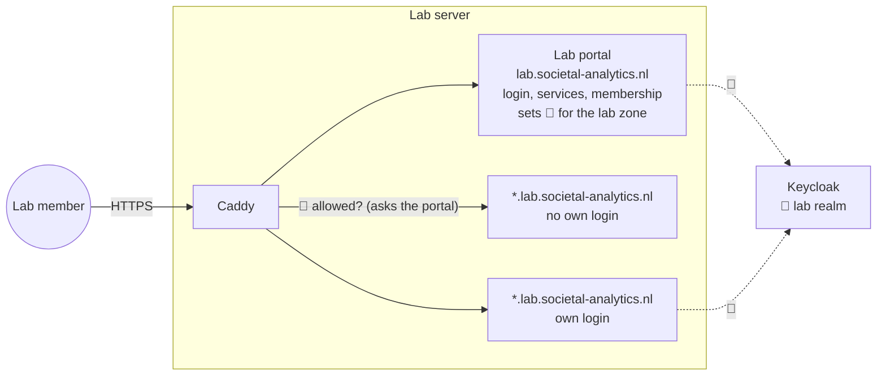

# Lab server

A physical server on VU premises that hosts the lab's services for its members, such as transcription (Whisper) and language models (Ollama). Every service has an address under `lab.societal-analytics.nl`, and `lab.societal-analytics.nl` itself is the lab portal: the login, an overview of the services, and lab membership. Which services run here: [Hosted services](services.md).

## Map

* **Caddy** is the only thing reachable from outside. It handles HTTPS (certificates from Let's Encrypt), and sends every request to the right service.
* **The lab portal** (`lab.societal-analytics.nl`) is the lab login. Members sign in there with their account in the `lab` realm of [Keycloak](keycloak.md) (a password and a second factor), and see the services they can use. After that login, the portal's cookie (🍪) works for every address under `lab.`.
* **Services without their own login** sit behind the portal: for every request, Caddy asks the portal whether this person may use the service. Visitors who aren't signed in are sent to the login first.
* **Lab membership:** a Keycloak account alone isn't enough. People request membership in the portal; a lab admin approves it there, and gets an email about new requests. Admins can also add and remove members directly.
* **Services with their own login** (e.g. a chat interface for the language models) are reached directly through Caddy, and log users in through Keycloak's `lab` realm themselves.
* **The rule:** every service under `lab.` either sits behind the portal, or has its own login through Keycloak. Never a separate password or token, so lab members have one account, with a second factor, for everything. (A service can let scripts use its own API keys on its API paths; see [Adding a service](../install/lab-server.md#2-adding-a-service).)
* **The services** listen only on the server itself (`127.0.0.1`), so they can't be reached around Caddy. Each one lives in its own directory in `/opt`, owned by a system account without a login, run with Docker Compose, with its files and database dumps backed up every night, and data with a short retention deleted after a set time ([Apps on our servers](../install/apps.md)).

### Who may use what

Set per service in `services.yml` on the server, which lab admins edit over SSH (not in the portal, so a stolen browser session can't change it):

| Access | Who |
| --- | --- |
| members | Lab members and lab admins |
| admins | Lab admins |
| public | Anyone: the service has its own login, or is public |

A service can also require that the login used a second factor (e.g. for services with sensitive data). Lab admins are listed in `groups.yml` on the server, and always need a recent login with a second factor for changes on the admin page.

## The lab zone: everything under `lab.`

Every service the lab runs for its members gets an address under `lab.societal-analytics.nl`, such as `whisper.lab.societal-analytics.nl`, with or without its own login. The DNS has two records for this server, `lab` and `*.lab`, so a new service needs no DNS change.

The lab login is **one login cookie for the whole zone**: after logging in once, members can use every service behind the lab login, and signing out ends the login for all of them.

!!! warning "Only the lab's own services under `lab.`"
    The browser sends the login cookie to **every** address under `lab.societal-analytics.nl`. Whoever receives it can use it to get into the services behind the lab login, as that user. So only services the lab runs on its own servers may be put under `lab.`, never a site hosted by someone else (an external website host, a SaaS product, a student's own server).

The lab's website (`societal-analytics.nl`, hosted on GitHub Pages) is outside the zone, and never receives the cookie. Services with their own login under `lab.` do receive it, but don't use it; they run on the same server, from where they could reach the other services anyway. Why one cookie for the zone, rather than one per service: [Decisions](../decisions.md#all-lab-services-under-lab-with-one-login-cookie-for-the-zone).

## Signing out, and inactivity

* **Sign out:** **Sign out** on the portal. It ends the login for all services and the session at Keycloak. Signing out in Keycloak (or an admin ending the session there) also ends the portal login.
* **Inactivity:** members who don't use the lab services for 2 hours (Keycloak's idle time for the `lab` realm) have to log in again, and everyone after at most 10 hours. Active members stay signed in: the portal checks the session with Keycloak every 10 minutes while they work, and a long request (e.g. a large upload) is never cut off.
* **Remember me:** members who tick it when they log in stay signed in on that device for up to 30 days, as long as they use it at least once a week.
* **A removed member** loses access immediately when removed in the portal, and within 10 minutes when their Keycloak account is disabled.

## Setup

How the server, the lab portal and new services are set up: [Installation: lab server](../install/lab-server.md).
