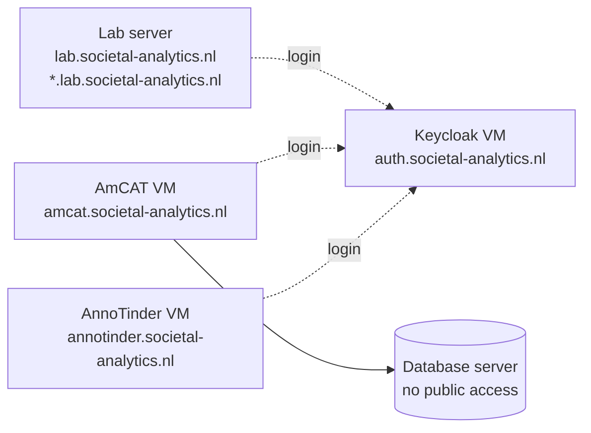

# Our servers

What runs where. Every server is set up the same way ([Setting up a server](server-setup.md)), and runs the [nightly backup](server-setup.md#backups) of its `/opt`. How each app is run: [Apps](apps.md).

## Keycloak VM

A VM on VU SciCloud ([University VMs](vm.md)). Reverse proxy: Caddy, part of the Keycloak deployment.

| Folder | App | Address |
| --- | --- | --- |
| `/opt/backup` | [Backup](server-setup.md#backups) | |
| `/opt/keycloak` | [Keycloak](apps.md#keycloak) | `auth.societal-analytics.nl` |

## Lab server

A physical server on VU premises, for the tools of lab members. Every app gets an address under `lab.societal-analytics.nl`. Reverse proxy: the [lab portal](apps.md#lab-portal) (Caddy, plus a login for apps without one).

| Folder | App | Address |
| --- | --- | --- |
| `/opt/backup` | [Backup](server-setup.md#backups) | |
| `/opt/lab-portal` | [Lab portal](apps.md#lab-portal) | `lab.societal-analytics.nl` |
| `/opt/whisper` | [Whisper](apps.md#whisper) | `whisper.lab.societal-analytics.nl` |
| `/opt/scriptorium` | [Scriptorium](apps.md#scriptorium) | `scriptorium.lab.societal-analytics.nl` |

## AmCAT VM

A VM on VU SciCloud. Reverse proxy: the Caddy that comes with AmCAT's compose file.

| Folder | App | Address |
| --- | --- | --- |
| `/opt/backup` | [Backup](server-setup.md#backups) | |
| `/opt/amcat` | [AmCAT](apps.md#amcat) | `amcat.societal-analytics.nl` |

## AnnoTinder VM

A VM on VU SciCloud. Reverse proxy: the Caddy that comes with AnnoTinder's compose file.

| Folder | App | Address |
| --- | --- | --- |
| `/opt/backup` | [Backup](server-setup.md#backups) | |
| `/opt/annotinder` | [AnnoTinder](apps.md#annotinder) | `annotinder.societal-analytics.nl` |

## Database server

A physical server on VU premises, with the databases of apps on other servers. No public access, so no reverse proxy: only the other servers connect, over the internal network. ==TODO: which servers, and with TLS.==

| Folder | App | Address |
| --- | --- | --- |
| `/opt/backup` | [Backup](server-setup.md#backups) | |
| `/opt/postgres` | [PostgreSQL](apps.md#postgresql) | internal |
| `/opt/elasticsearch` | [Elasticsearch](apps.md#elasticsearch) | internal |

IP addresses and admin hostnames are not published here.
